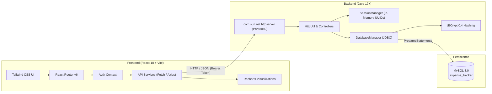

# Expenzo 2.0 — Modern Personal Expense & Budget Tracker

Expenzo 2.0 is a full-stack personal finance and budget management platform. It modernizes the original Expenzo desktop application into a responsive web application powered by **React 18**, **TypeScript**, **Tailwind CSS**, and **Recharts**, while preserving the original **Java 17+** backend, **JDBC** data access, and **MySQL 8.0** database. The original Java Swing desktop client remains functional as a dual-entry fallback.

---

## Table of Contents

- [Key Features](#key-features)
- [Architecture & Tech Stack](#architecture--tech-stack)
- [Prerequisites](#prerequisites)
- [Database Setup](#database-setup)
- [Environment Configuration](#environment-configuration)
- [Building and Running](#building-and-running)
  - [1. Backend API Server](#1-backend-api-server)
  - [2. React Web Frontend (Development)](#2-react-web-frontend-development)
  - [3. React Web Frontend (Production Build)](#3-react-web-frontend-production-build)
  - [4. Legacy Java Swing Desktop App](#4-legacy-java-swing-desktop-app)
- [REST API Specification](#rest-api-specification)
- [Security Architecture](#security-architecture)
- [Project Directory Structure](#project-directory-structure)
- [Verification & Testing](#verification--testing)

---

## Key Features

1. **Executive Dashboard**:
   - Real-time monthly financial KPI cards (Total Expenses, Monthly Budget, Remaining Budget, Transaction Count).
   - Dynamic budget threshold alerts banner (`APPROACHING` at 75%, `WARNING` at 90%, `EXCEEDED` at 100%).
   - Interactive data visualizations with Recharts:
     - Category-wise spending donut / pie chart.
     - Monthly category spending breakdown bar chart.
     - 6-month historical spending trend area / line chart.
   - Highest spending category spotlight and 5 most recent transactions.

2. **Expense Management**:
   - Full CRUD operations (Add, View, Edit, Delete).
   - Real-time live search across descriptions.
   - Category filtering and date range filtering (`startDate` to `endDate`).
   - Dynamic sorting by Date or Amount (Ascending / Descending).
   - Support for multiple payment methods (Cash, Credit Card, Debit Card, UPI, Net Banking).

3. **Budget Tracking & Automated Alerts**:
   - Monthly category budget allocations with dynamic spent, remaining, and percentage calculations.
   - Color-coded progress indicators:
     - **Green (Normal)**: Spending < 75%.
     - **Yellow (Approaching)**: Spending between 75% and 89.9%.
     - **Orange (Warning)**: Spending between 90% and 99.9%.
     - **Red (Exceeded)**: Spending >= 100%.

4. **Analytics & Monthly Reporting**:
   - Dedicated Monthly Reports viewer with Month/Year selector.
   - Category-wise expense vs. budget comparative tables.
   - One-click CSV report export with automatic UTF-8 BOM encoding and CSV formula injection protection.

5. **Settings & Account Management**:
   - Profile overview displaying account details and member date.
   - Secure session revocation / logout.

6. **Dual Entry & Legacy Support**:
   - Retains the original Java Swing GUI client without regressions.
   - Supports transparent password migration from legacy plaintext to salted BCrypt hashes.

---

## Architecture & Tech Stack



- **Frontend**: React 18, TypeScript, Vite 6, Tailwind CSS, Lucide React, React Router v6, Recharts.
- **Backend**: Java 17+, `com.sun.net.httpserver.HttpServer` (zero external web framework), Google Gson 2.10.1, jBCrypt 0.4.
- **Database**: MySQL 8.0 with `mysql-connector-j` 8.3.0.
- **Precision**: `BigDecimal` arithmetic for all monetary calculations.

---

## Prerequisites

Ensure the following tools are installed and available on your system `PATH`:

- **Java JDK 17** or higher (`java -version`)
- **Apache Maven 3.8+** (`mvn -v`)
- **Node.js 18+** and **npm 9+** (`node -v`, `npm -v`)
- **MySQL Server 8.0+** running locally on port 3306

---

## Database Setup

1. Start your local MySQL service (e.g. `MySQL80` service on Windows or `systemctl start mysql` on Linux).
2. Execute the database initialization script located at `src/main/resources/database.sql`:

```sql
mysql -u root -p < src/main/resources/database.sql
```

The database `expense_tracker` will be initialized with the 4 normalized tables:
- `users`: User authentication records.
- `categories`: Category definitions (per-user and system defaults).
- `expenses`: Transaction records with category reference, date, amount, and payment mode.
- `budgets`: Category-specific monthly budget caps.

---

## Environment Configuration

Create a `.env` file in the root of the project directory (refer to `.env.example` if available):

```properties
# Database Configuration
DB_URL=jdbc:mysql://localhost:3306/expense_tracker
DB_USER=root
DB_PASSWORD=your_mysql_password

# API Server Configuration
PORT=8080
```

---

## Building and Running

### 1. Backend API Server

Compile and launch the Java REST API server:

```bash
# Compile Java classes
mvn clean compile

# Launch the API server on port 8080
mvn exec:java -Dexec.mainClass="com.expensetracker.Main" -Dexec.args="api"
```

*Direct Java execution alternative:*
```bash
java -cp "target/classes;target/dependency/*" com.expensetracker.Main api
```

The server will output:
```text
Database connection: OK
=================================================
 Expenzo 2.0 API Server started on port 8080
 Health check: http://localhost:8080/api/health
 Base URL:     http://localhost:8080/api
=================================================
```

### 2. React Web Frontend (Development)

Open a new terminal window:

```bash
cd frontend
npm install
npm run dev
```

The frontend development server will launch at:
- **Local URL**: `http://localhost:5173`
- API calls to `/api/*` are automatically proxied to `http://localhost:8080/api/*` via Vite configuration.

### 3. React Web Frontend (Production Build)

To build the optimized static production bundle:

```bash
cd frontend
npm run build
```

This creates a production-ready `frontend/dist` directory with chunk splitting (vendor, icons, charts). You can preview the production build locally with:

```bash
npm run preview
```

### 4. Legacy Java Swing Desktop App

To run the original desktop GUI application without starting the web server:

```bash
# Launch without arguments or with 'gui'
mvn exec:java -Dexec.mainClass="com.expensetracker.Main"
```

---

## REST API Specification

All API endpoints return a standardized JSON envelope:

```json
{
  "success": true,
  "message": "Operation description",
  "data": { ... }
}
```

Protected endpoints require the HTTP header:
`Authorization: Bearer <session_token>`

### 1. Health
- `GET /api/health`: Health status and MySQL connectivity check.

### 2. Authentication
- `POST /api/auth/register`: Register a new user account. Auto-provisions default categories and generates a session token.
  - Body: `{ "name": "...", "email": "...", "password": "..." }`
- `POST /api/auth/login`: Authenticate with email and password. Automatically verifies and upgrades legacy plaintext passwords to BCrypt.
  - Body: `{ "email": "...", "password": "..." }`
- `GET /api/auth/me`: Validate current session token and retrieve user profile details.
- `POST /api/auth/logout`: Revoke the current session token.

### 3. Categories
- `GET /api/categories`: Fetch all categories available to the authenticated user.

### 4. Expenses
- `GET /api/expenses`: Retrieve expenses scoped to the user.
  - Query parameters:
    - `search` (string): Partial match against expense descriptions.
    - `categoryId` (int): Filter by specific category.
    - `startDate` (YYYY-MM-DD): Filter transactions starting from this date.
    - `endDate` (YYYY-MM-DD): Filter transactions up to this date.
    - `sortBy` (`expense_date` | `amount`): Sort attribute.
    - `sortOrder` (`ASC` | `DESC`): Sort direction.
- `POST /api/expenses`: Record a new expense.
  - Body: `{ "categoryId": 1, "amount": 45.50, "expenseDate": "2026-11-02", "description": "Groceries", "paymentMode": "Credit Card" }`
- `PUT /api/expenses/{id}`: Modify an existing expense record owned by the user.
- `DELETE /api/expenses/{id}`: Delete an expense record owned by the user.

### 5. Budgets & Alerts
- `GET /api/budgets`: Retrieve all budget allocations for a specific month and year.
  - Query parameters: `month` (1-12), `year` (YYYY).
- `POST /api/budgets`: Create a budget limit for a category and month.
  - Body: `{ "categoryId": 1, "budgetAmount": 500.00, "month": 11, "year": 2026 }`
- `PUT /api/budgets/{id}`: Update an existing budget limit.
- `DELETE /api/budgets/{id}`: Remove a budget allocation.
- `GET /api/budgets/alerts`: Retrieve calculated budget consumption and threshold alert states (`NORMAL`, `APPROACHING` >=75%, `WARNING` >=90%, `EXCEEDED` >=100%).
  - Query parameters: `month` (1-12), `year` (YYYY).

### 6. Analytics
- `GET /api/analytics`: Aggregate metrics and historical trends for the dashboard.
  - Query parameters: `month` (1-12), `year` (YYYY).
  - Returns:
    - `totalExpenses`: Monthly spent total.
    - `totalBudget`: Monthly budget sum.
    - `remainingBudget`: Remaining budget.
    - `transactionCount`: Total transactions in selected month.
    - `highestSpendingCategory`: Name of top spending category.
    - `categoryBreakdown`: Array of `{ categoryId, categoryName, amount, percentage }`.
    - `monthlyTrends`: 6-month historical spending timeline array `{ monthYear, totalAmount }`.
    - `recentTransactions`: Last 5 expenses.

### 7. Reports & CSV Export
- `GET /api/reports/monthly`: Comprehensive report data for a selected month and year.
- `GET /api/reports/export`: Streams an RFC-4180 compliant CSV file (`Content-Type: text/csv`).
  - Query parameters: `month` (1-12), `year` (YYYY).
  - Includes UTF-8 BOM (`\uFEFF`) for spreadsheet compatibility.
  - Implements CSV Formula Injection sanitization on all text fields.

---

## Security Architecture

1. **Password Security & BCrypt Migration**:
   - New user registrations are hashed using **BCrypt** with work factor 12 (`$2a$12$`).
   - Legacy users stored with plaintext passwords can log in seamlessly; their passwords are transparently hashed and upgraded in MySQL upon first login.
   - API endpoints redact password fields completely — no password or hash is ever sent across the wire.

2. **Session Authentication & Scoped Authorization**:
   - Secure UUID v4 tokens managed in a thread-safe, concurrent session registry.
   - Sessions are validated on every request.
   - Every database query binds `userId = ?` from the authenticated session. The frontend cannot access, modify, or spoof records of another user.

3. **SQL Injection Defense**:
   - All database queries use JDBC `PreparedStatement` with strict parameter binding. No string concatenation is used for SQL generation.
   - Expense sorting parameters use an explicit whitelist (`expense_date`, `amount`, `ASC`, `DESC`).

4. **CSV Formula Injection (Spreadsheet Macro Injection) Mitigation**:
   - The CSV exporter inspects all text fields. Any field beginning with formula trigger characters (`=`, `+`, `-`, `@`, `\t`, `\r`) is automatically prepended with a single quote (`'`), rendering it inert in Excel, Google Sheets, and LibreOffice.

5. **Financial Precision**:
   - All currency values are calculated and handled using `java.math.BigDecimal` to eliminate floating-point rounding inaccuracies.

---

## Project Directory Structure

```text
Expenzo/
├── .env                          # Local database & server environment configuration
├── pom.xml                       # Maven build file (Java 17, Gson, jBCrypt, MySQL Connector)
├── README.md                     # Comprehensive project documentation
├── INSTRUCTIONS.md               # Technical project specification
├── src/
│   ├── main/
│   │   ├── java/com/expensetracker/
│   │   │   ├── Main.java         # Dual entry: GUI (Swing) vs CLI/API Server
│   │   │   ├── api/
│   │   │   │   ├── ApiServer.java             # Lightweight Java HTTP Server
│   │   │   │   ├── SessionManager.java        # In-memory thread-safe session store
│   │   │   │   ├── HttpUtil.java              # CORS, routing, and JSON utilities
│   │   │   │   ├── JsonUtil.java              # Gson ISO-8601 LocalDate adapter
│   │   │   │   ├── ApiResponse.java           # Standardized API response envelope
│   │   │   │   ├── AuthController.java        # Registration, login, logout, profile
│   │   │   │   ├── CategoryController.java    # Category listings
│   │   │   │   ├── ExpenseController.java     # Expense CRUD, search, filter, sort
│   │   │   │   ├── BudgetController.java      # Budget CRUD and threshold alerts
│   │   │   │   ├── AnalyticsController.java   # KPIs, trends, category breakdowns
│   │   │   │   ├── ReportController.java      # Monthly report and secure CSV export
│   │   │   │   └── dto/                       # Data Transfer Objects
│   │   │   ├── database/
│   │   │   │   ├── DatabaseConnection.java    # JDBC connection manager
│   │   │   │   └── DatabaseManager.java       # Parameterized DAO operations & BCrypt
│   │   │   ├── gui/                           # Legacy Java Swing GUI components
│   │   │   └── model/                         # Domain POJOs (User, Expense, Category, Budget)
│   │   └── resources/
│   │       └── database.sql                   # MySQL schema definitions
└── frontend/                                  # React 18 + Vite + TypeScript application
    ├── package.json
    ├── tsconfig.json
    ├── vite.config.ts                         # Proxy config & rollup chunk splitting
    ├── tailwind.config.js                     # Dark theme configuration
    ├── index.html
    └── src/
        ├── main.tsx                           # React DOM mount
        ├── App.tsx                            # Protected routing and page views
        ├── types/                             # TypeScript interfaces matching backend DTOs
        ├── services/                          # API clients (auth, expenses, budgets, analytics, reports)
        ├── context/                           # AuthContext for state & token persistence
        ├── components/                        # UI components (Header, Sidebar, StatCard, Loading, Empty)
        ├── utils/                             # formatCurrency (USD) & date formatting
        └── pages/                             # Modern dark-themed responsive pages:
            ├── Login.tsx
            ├── Register.tsx
            ├── Dashboard.tsx
            ├── Expenses.tsx
            ├── Budgets.tsx
            ├── Reports.tsx
            └── Settings.tsx
```

---

## Verification & Testing

Expenzo 2.0 includes an automated end-to-end verification suite testing:
- API Server Health & MySQL connectivity
- BCrypt hashing lifecycle & token revocation
- Data consistency across Expense and Budget operations
- Alert thresholds (76% Approaching, 92% Warning, 104% Exceeded)
- Search, multi-criteria filtering, and sorting
- Monthly reports and sanitized CSV exports
- Cross-user tenant isolation & unauthenticated request protection
- Swing desktop application launch compatibility

All **46 automated test assertions** pass cleanly with 0 failures.
